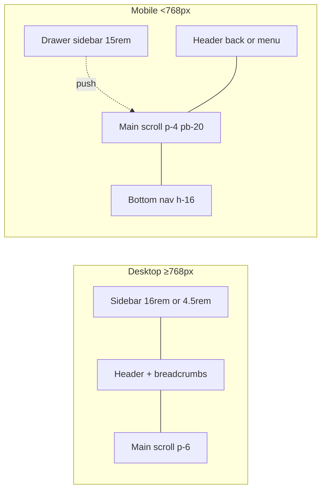

# Edspire frontend — app shell design principles

Use this document when rebuilding **the same sidebar, top navbar, and mobile layout** in another React project. It describes the **layout system**, not business features (CRM, fees, etc.).

---

## 1. Goals

- **One authenticated shell** wraps all in-app routes: sidebar + header + scrollable main + optional mobile bottom nav.
- **Desktop:** persistent sidebar (expand/collapse), breadcrumbs in header, dense toolbar actions.
- **Mobile (&lt;768px):** drawer-style sidebar with “card push” animation, simplified header, bottom tab bar for primary destinations.
- **Safe areas:** respect iOS notch/home indicator and PWA standalone mode.
- **Role-aware chrome:** admin, teacher, and student headers differ; behavior is documented so you can simplify for a greenfield app.

---

## 2. Stack assumptions

| Piece | This repo |
|--------|-----------|
| UI primitives | [shadcn/ui](https://ui.shadcn.com) — especially `components/ui/sidebar.tsx` |
| Styling | Tailwind CSS + CSS variables in `src/index.css` |
| Icons | Lucide React |
| Routing | React Router (`Outlet` / nested routes in `App.tsx`) |
| Breakpoint | **768px** — `useIsMobile()` in `src/hooks/use-mobile.tsx` (`max-width: 767px`) |

Copy or re-implement the same sidebar component API (`SidebarProvider`, `useSidebar`, `AppSidebar` pattern).

---

## 3. Shell architecture

```
DashboardLayout
├── PersistentSidebarProvider     ← desktop open state + user pref persistence
│   └── SearchProvider (optional)
│       └── LayoutContent
│           ├── AppSidebar          ← nav tree (desktop + mobile drawer)
│           └── Main column
│               ├── [overlay]       ← tap to close mobile sidebar
│               ├── HeaderBar         ← sticky top navbar
│               ├── <main>            ← page content (Outlet/children)
│               └── MobileBottomNav   ← md:hidden fixed bottom (optional)
```

**Entry point:** wrap protected routes with `<DashboardLayout>{children}</DashboardLayout>` (see `src/App.tsx`).

**Reference files:**

| Concern | File |
|---------|------|
| Shell orchestration | `src/components/DashboardLayout.tsx` |
| Navigation tree | `src/components/AppSidebar.tsx` |
| shadcn sidebar primitives | `src/components/ui/sidebar.tsx` |
| Mobile tabs | `src/components/MobileBottomNav.tsx` |
| Theme tokens | `src/index.css` |
| Mobile page title/back override | `src/lib/mobileTopBarOverride.ts` |
| Portal slot for page actions in header | `#mobile-header-action-slot` + `src/lib/mobileHeaderActionStore.ts` |

---

## 4. Layout geometry

### 4.1 Root container

- Height: **`100dvh`** (not `100vh`) — avoids mobile browser chrome jumps.
- **Desktop:** outer background `bg-sidebar`; inner main column `bg-background`.
- **Mobile:** outer background **`bg-primary`** (brand strip visible when sidebar opens).

### 4.2 Sidebar widths (from `sidebar.tsx`)

| Token | Value |
|--------|--------|
| Expanded | `16rem` (`SIDEBAR_WIDTH`) |
| Collapsed (icon rail) | `4.5rem` (`SIDEBAR_WIDTH_ICON`) |
| Mobile drawer | `15rem` (`SIDEBAR_WIDTH_MOBILE`) |

Desktop collapse is **not** off-canvas; it shrinks to icon-only. Mobile sidebar is **off-canvas** until opened.

### 4.3 Mobile “Trello-style” push (main column)

When `openMobile === true`:

- Main column: `translate-x-[15rem] scale-[0.92] rounded-2xl shadow-2xl` (~300ms ease).
- Semi-transparent overlay on main column; click closes drawer.
- **Lock** `document.documentElement` and `body` `overflow: hidden` while drawer is open.

### 4.4 Main content area

Default (most pages):

```txt
flex-1 p-4 md:p-6 overflow-y-auto scrollbar-thin pb-20 md:pb-6
```

- **`pb-20` on mobile** reserves space for `MobileBottomNav` (`h-16` + safe area).
- **Full-bleed routes** (e.g. internal chat, CMS editor, AI builder): `p-0 overflow-hidden`, no bottom nav — see `hideAppChrome` / `isFullBleedChat` in `DashboardLayout.tsx`.

---

## 5. Top navbar (`HeaderBar`)

Shared traits:

- **Sticky** top, `z-10`, `border-b border-border/50`, `bg-background/60 backdrop-blur-md`.
- **Min height:** `3.5rem` + `env(safe-area-inset-top)` (with extra logic for iPhone PWA — see `useIphoneStandaloneSafeTop` in `DashboardLayout.tsx`).

### 5.1 Admin (desktop ≥768px)

- Left: sidebar toggle (`PanelLeft`), **breadcrumbs** (Home → … → current page).
- Center/right: global search, campus switcher (if applicable), notifications, theme toggle, profile menu.
- Breadcrumb current title comes from route map + optional `setMobileTopBarOverride({ title })` on mobile only.

### 5.2 Admin (mobile)

- **Home / forced password change:** hamburger opens sidebar (not back).
- **Inner pages:** back (`ArrowLeft`) + optional title (title hidden for admin on mobile in this product).
- Campus switcher remains visible on mobile for admins.
- Page-specific actions can mount into **`#mobile-header-action-slot`**.

### 5.3 Teacher / student (mobile)

- **3-column grid:** menu or back | centered logo | theme / notifications / actions.
- **Home:** hamburger; **elsewhere:** back (or custom `onBack` from mobile top bar override).

### 5.4 Desktop sidebar toggle

- Hidden on mobile (`md:flex`); toggles expanded vs collapsed, **not** the mobile drawer.
- Mobile drawer uses `setOpenMobile(true)` from hamburger buttons.

---

## 6. Sidebar navigation (`AppSidebar`)

Principles:

- **Permission-driven menu** in this app; in a new project, replace with static config or your own RBAC.
- **Desktop collapsed:** groups collapse to icon + tooltip; use command palette pattern for group labels if needed.
- **Desktop expanded:** labeled groups, collapsible sections, `NavLink` with active styles.
- **Mobile drawer:** full-width primary-colored nav (`text-primary-foreground`), larger tap targets (`py-3`, 15px text), collapsible groups with chevron.
- **Footer:** user block + logout on desktop; mobile footer uses safe-area padding `pb-[max(1.25rem,env(safe-area-inset-bottom))]`.

Active route matching:

- Compare pathname to item URL **without query/hash**, allow prefix match for nested routes where intentional.

---

## 7. Mobile bottom navigation

- **Visible:** `md:hidden`, `fixed bottom-0 inset-x-0 z-30`, `h-16`, top border + light shadow.
- **Items:** 4 tabs typical (Home + 3 modules) — role-specific arrays in `MobileBottomNav.tsx`.
- **Hide on focus routes:** long forms, full-screen tools (see `HIDE_ON_PATHS`).
- **Not shown** when mobile sidebar is open (`shifted`) or on full-bleed chat routes.
- **Safe area:** `paddingBottom: env(safe-area-inset-bottom)` on the nav element.

When porting, define **one** bottom nav config per persona; do not duplicate sidebar links 1:1 — pick the highest-traffic destinations.

---

## 8. Design tokens (minimum set)

Define in `:root` / `.dark` (see `src/index.css`):

- **Layout:** `--background`, `--foreground`, `--border`, `--radius` (default `0.625rem`)
- **Sidebar:** `--sidebar-background`, `--sidebar-foreground`, `--sidebar-accent`, `--sidebar-border`
- **Semantic:** `--primary`, `--muted`, `--destructive`, `--accent`
- **Typography:** Google Sans / Product Sans (or substitute one sans family for both projects)

Dark mode: class **`.dark`** on `html` or root (see `src/lib/themeStore.ts`).

Use **HSL components** in CSS variables (`220 20% 97%`) with Tailwind `hsl(var(--background))` pattern from shadcn.

---

## 9. Responsive page patterns (inside `<main>`)

Apply these inside pages so they match the shell:

| Pattern | Convention |
|---------|------------|
| Page title (desktop) | Often in header via breadcrumbs; avoid duplicate H1 unless marketing page |
| Filters | Desktop: card row; mobile: compact search + **Sheet** bottom drawer for filters (see `Leads.tsx`) |
| Data tables | `overflow-x-auto` wrapper; on mobile prefer cards or horizontal scroll, not shrinking text below 11px |
| Primary actions | Desktop: top-right of filter card; mobile: FAB or slot in `#mobile-header-action-slot` |
| Breakpoint prefix | `sm:` 640px, `md:` 768px (shell), `lg:` 1024px for grid columns |

---

## 10. Extension hooks (keep when porting)

### Mobile top bar override

```ts
// src/lib/mobileTopBarOverride.ts
setMobileTopBarOverride({ title: "Edit lead", onBack: () => navigate("/leads") });
// clear on unmount: setMobileTopBarOverride(null);
```

Use for wizards and nested views where `navigate(-1)` is wrong.

### Hide app chrome

Routes that need full viewport (editors, builders):

- Do not render sidebar/header/bottom nav (`hideAppChrome` pattern in `LayoutContent`).
- Still wrap in `DashboardLayout` if you need providers, or use a parallel layout route.

### Sidebar persistence

- Desktop expanded/collapsed: persisted to user preferences API in this product (`patchSidebarExpanded`).
- In a new project, cookie or `localStorage` is enough; wire `SidebarProvider` `open` / `onOpenChange`.

---

## 11. Porting checklist

Copy or reimplement in order:

1. `src/index.css` (tokens + base styles)
2. `src/components/ui/sidebar.tsx` (+ shadcn Sheet, Button, Tooltip dependencies)
3. `src/hooks/use-mobile.tsx`
4. `src/components/AppSidebar.tsx` (replace menu data)
5. `src/components/DashboardLayout.tsx` (trim tenant-specific header widgets if needed)
6. `src/components/MobileBottomNav.tsx` (simplify items)
7. `src/lib/mobileTopBarOverride.ts`
8. Wrap routes in `App.tsx` with `DashboardLayout`

**Smoke tests after port:**

- [ ] Desktop: collapse sidebar, breadcrumbs update on navigation
- [ ] Mobile: open drawer → push animation → overlay tap closes
- [ ] Mobile: bottom nav clears last tab item; main scroll does not hide under nav (`pb-20`)
- [ ] iOS PWA: header not under status bar; bottom nav above home indicator
- [ ] Dark mode toggles sidebar + header + main consistently
- [ ] One inner page sets mobile title override and custom back

---

## 12. Anti-patterns

- Using **`100vh`** for the shell on mobile — use **`100dvh`**.
- Putting **two scroll containers** (shell + page) without `min-h-0` on flex children — causes scroll traps.
- Showing **both** hamburger and bottom nav items for every module — bottom nav should stay short.
- **Duplicating** sidebar state in cookies and API without a single source of truth.
- Forgetting **`pb-20`** on main when bottom nav is enabled.
- Desktop sidebar **overlay-only** without collapsed rail — differs from this product’s desktop UX.

---

## 13. Optional diagram



---

## 14. Related assets

- Brand / marketing color spec (separate): `frontend/public/t/DESIGN.md` (Elite Visual palette — optional for non-shell pages).
- Logo components: `src/components/EdspireLogo.tsx` — swap for your brand in a fork.

---

*Last aligned with: `DashboardLayout.tsx`, `AppSidebar.tsx`, `MobileBottomNav.tsx`, `ui/sidebar.tsx` in edspire-fullstack.*
